# Vervain Context Firewall: Architecture & Design

**Feature scope:** Proposed hackathon prototype demonstrating pre-inference context admission, release-time policy-epoch recheck, content-free hash-chained receipts, and an executable TypeScript reference calculation for Scoped Attention across 2 of 2 mediated application boundaries (`retrieval_to_gemini_context_envelope` and `gemini_response_to_browser_release`) inside this web service.

---

## 1. Single-Service Full-Stack Architecture

Vervain Context Firewall is structured as a single deployable TypeScript service targeting Node.js `>=22.0.0` for Google Cloud Run and AI Studio export:

- **Unified HTTP Origin:** In production (`src/server/index.ts` -> `src/server/app.ts`), 1 of 1 Node HTTP process binds `0.0.0.0:8080` (`ENV PORT=8080`), routing `/healthz`, `/readyz`, and `/api/*` through `handleApiOrProbeRequest` (`src/server/routes.ts`) while serving pre-built static assets from `dist/client` behind strict directory-containment checks (`candidatePath.startsWith(resolvedClientDir + path.sep)`).
- **Build Topology:** `npm run build` executes 2 of 2 deterministic build stages in sequence:
  1. `npm run build:client` (`vite build` via `vite.config.ts`) bundles `index.html`, `src/client/**`, and `src/shared/**` into `dist/client` with `sourcemap: false`.
  2. `npm run build:server` (`tsc -p tsconfig.server.json`) compiles `src/shared/**/*.ts` and `src/server/**/*.ts` (excluding 1 of 14 server files, the local Vite proxy helper `src/server/dev.ts`) into `dist/server`, producing runtime entrypoint `dist/server/server/index.js`.
- **Zero External Database Dependency:** Session authority (`SessionStore`) and audit history (`AuditLedger`) live in bounded in-process memory structures (`maxSessionsInMemory = 2048` active session slots per running instance; `SafeStructuredLogger` ring buffer capped at `1000` structured log entries per instance). Instance restarts clear synthetic run history, which is surfaced directly in `RuntimeStatusView.instanceLifetimeNote` and every receipt's `chain.rollback_note`.
- **Server-Only Gemini Integration:** Only `src/server/gemini.ts` imports `@google/genai`. The browser bundle (`src/client/**`) communicates exclusively with same-origin `/api/*` routes and holds 0 of 1 server API keys (`GEMINI_API_KEY`).

---

## 2. Module Boundary Map

The codebase separates untrusted browser rendering (`src/client`), wire-boundary validation and shared constants (`src/shared`), and trusted deterministic enforcement (`src/server`).

### 2.1 Shared Modules (`src/shared` - 3 of 3 modules)

| Module | Primary Exports | Responsibility & Trust Boundary |
| :--- | :--- | :--- |
| [config.ts](file:///Users/pjmullin/Desktop/vervain-carbon-demo/src/shared/config.ts) | `MEDIATED_BOUNDARIES`, `RECEIPT_EXCLUSIONS`, `ALLOWED_CLASSIFICATIONS_BY_DESTINATION`, `MAX_ADMITTED_CHUNKS`, `MAX_CHUNK_UTF8_BYTES`, `MAX_REQUEST_BODY_BYTES`, `SCOPED_ATTENTION_LIMITATION_LABEL` | Public constants defining the 2 of 2 mediated boundaries, 7 of 7 explicit receipt exclusions, and fixed byte/count caps (`4` max admitted chunks, `4096` max UTF-8 bytes per chunk, `8192` max request body UTF-8 bytes). Never reads `process.env`. |
| [reason-codes.ts](file:///Users/pjmullin/Desktop/vervain-carbon-demo/src/shared/reason-codes.ts) | `CHUNK_DISPOSITIONS`, `ADMISSION_REASONS`, `RELEASE_DECISIONS`, `RELEASE_REASONS`, `PROVIDER_OUTCOMES`, `PERMITTED_TASK_BASES`, `API_ERROR_CODES` | Fixed machine-readable enums for all 11 of 11 admission reason codes, 11 of 11 release reason codes, 8 of 8 provider outcomes, and 16 of 16 API error codes. Carries zero secret or authority state. |
| [contracts.ts](file:///Users/pjmullin/Desktop/vervain-carbon-demo/src/shared/contracts.ts) | `parseStrictJson`, `detectClientAuthorityOverride`, `validatePersonaSessionPayload`, `validateEmptyMutationPayload`, `ContextReceipt`, `DemoStateResponse`, `ScopedAttentionProofView` | Wire-input validation before server execution touches session state. Scans raw JSON tokens per RFC 8259 to reject duplicate keys at any depth up to `16` nested levels, rejects `__proto__` / `constructor` / `prototype`, converts parsed objects via `Object.create(null)`, and rejects 25 of 25 normalized authority/provider override field names across headers, query strings, and bodies. |

### 2.2 Server Modules (`src/server` - 14 of 14 modules)

| Module | Primary Exports | Responsibility & Trust Boundary |
| :--- | :--- | :--- |
| [config.ts](file:///Users/pjmullin/Desktop/vervain-carbon-demo/src/server/config.ts) | `loadServerConfig`, `ServerConfig` | Trusted process environment loader. Centralizes `GEMINI_API_KEY`, `GEMINI_MODEL` (validated against `/^[a-zA-Z0-9._-]{3,80}$/`, defaulting to `gemini-2.5-flash`), `DEMO_MODE` (`live` or `mock`), `SESSION_SECRET`, temperature (`0`), max output tokens (`256`), timeout (`12000` ms default), retries (`2` max retries), and spend caps. |
| [session.ts](file:///Users/pjmullin/Desktop/vervain-carbon-demo/src/server/session.ts) | `SessionStore`, `buildSetCookieHeader`, `extractCookieFromHeader`, `ServerAuthoritySnapshot` | Sole authority oracle for `tenantId`, `principalId`, `policyId`, `policyEpoch`, `requestScopeTag`, and `stateGeneration`. Signs 32-byte random hex session IDs with HMAC-SHA256 (`vervain.session.v1:${sessionId}`), verifies tokens via `crypto.timingSafeEqual`, rotates sessions on persona switch, and enforces per-session rate and Gemini call caps. |
| [fixture.ts](file:///Users/pjmullin/Desktop/vervain-carbon-demo/src/server/fixture.ts) | `TENANT_FIXTURES`, `ALDER_RECORD`, `BEACON_RECORD`, `FROZEN_RECORDS`, `FROZEN_QUERY_TEXT`, `SYNTHETIC_PLANTED_VALUE`, `lookupFrozenRecordBySourceId` | Deterministic synthetic store containing 2 of 2 tenant personas (`alder` at epoch `7` with scope `0x00a1de07`; `beacon` at epoch `11` with scope `0x00beac11`) and 2 of 2 server records (`alder/renewal-playbook-v3` and `beacon/strategy-note-v2` carrying synthetic token `BEACON_PROJECT_EMBER_742` plus an embedded hostile override string). |
| [retrieval.ts](file:///Users/pjmullin/Desktop/vervain-carbon-demo/src/server/retrieval.ts) | `retrieveTenantScopedChunks`, `retrieveBrokenControlChunks` | Ordinary retrieval (`retrieveTenantScopedChunks`) applies 3 of 3 store predicates (`tenantId`, `policyEpoch`, destination `classification`). Defective control retrieval (`retrieveBrokenControlChunks`) omits predicates solely when invoked with literal `'cross_tenant_filter_omission'` inside the paired proof workflow. |
| [admission.ts](file:///Users/pjmullin/Desktop/vervain-carbon-demo/src/server/admission.ts) | `evaluateContextAdmission`, `isVerifiedAdmittedChunk`, `AdmittedChunk` | Independent pre-inference gate executing 6 of 6 ordered deterministic checks against server authority and frozen record digests. Mints `AdmittedChunk` objects registered in module-private `VERIFIED_ADMITTED_CHUNKS` (`WeakSet`) and strips rejected text from `ChunkAdmissionDecision`. |
| [envelope.ts](file:///Users/pjmullin/Desktop/vervain-carbon-demo/src/server/envelope.ts) | `buildVervainGeminiEnvelope`, `buildUnmediatedControlEnvelopeForSyntheticDefectOnly`, `GeminiOutboundEnvelope` | Outbound prompt sink. `buildVervainGeminiEnvelope` requires `AdmittedChunk[]` verified at runtime via `isVerifiedAdmittedChunk`. Computes canonical `envelopeSha256` and `promptUtf8Bytes`. Separates the `paired_defect` control builder from governed routes. |
| [gemini.ts](file:///Users/pjmullin/Desktop/vervain-carbon-demo/src/server/gemini.ts) | `OfficialGoogleGenAITransport`, `DeterministicMockGeminiTransport`, `SpyGeminiTransport`, `executeGeminiEnvelope` | Official `@google/genai` server adapter using structured JSON `responseSchema` (`answer`, `sources_used`), `AbortController` timeout, bounded exponential backoff with jitter solely on HTTP `429` and `503` (up to `geminiMaxRetries` retries, default `2`), `8192`-byte response ceiling, and content-free structured telemetry. |
| [release.ts](file:///Users/pjmullin/Desktop/vervain-carbon-demo/src/server/release.ts) | `ResponseReleaseGate` | Final server gate before browser delivery. Enforces single-release idempotency per `requestId`, reloads live `SessionStore` snapshot to recheck `sessionId`, `tenantId`, `principalId`, `stateGeneration`, expiry, and `policyEpoch`, and performs a secondary exact match scan for `SYNTHETIC_PLANTED_VALUE`. |
| [ledger.ts](file:///Users/pjmullin/Desktop/vervain-carbon-demo/src/server/ledger.ts) | `AuditLedger`, `canonicalJsonString`, `computeEventSha256`, `computeReceiptChainSha256` | Deterministic canonical JSON serializer, append-only in-instance event store chaining 6 of 6 stage events per run from `GENESIS_CHAIN_SHA256`, and `verifyChain()` recomputation across all stored events and receipts. |
| [receipts.ts](file:///Users/pjmullin/Desktop/vervain-carbon-demo/src/server/receipts.ts) | `buildAndAppendRunReceipt` | Assembles domain-separated SHA-256 digests (`session`, `principal`, `tenant`, `source`, `response`), denominator-bound chunk counts, mediated boundary names, and exclusions into `ContextReceipt`, running `findProhibitedContentInObject` prior to ledger commit. |
| [redaction.ts](file:///Users/pjmullin/Desktop/vervain-carbon-demo/src/server/redaction.ts) | `sha256Hex`, `domainSeparatedDigest`, `sanitizeLogToken`, `SafeStructuredLogger`, `findProhibitedContentInObject` | Strips ANSI CSI sequences and control bytes from log tokens and recursively scans exported structures against fixture strings, session IDs, API keys, `AIza...` key patterns, bearer tokens, and session cookies. |
| [scoped-attention.ts](file:///Users/pjmullin/Desktop/vervain-carbon-demo/src/server/scoped-attention.ts) | `runReferencePagedAttention`, `buildScopedAttentionProofForSession`, `formatScopeHex` | Executable reference paged-KV attention math over a 4-block pool (`blockSize = 2`, `headDim = 4`) bound strictly to server-owned `authority.requestScopeTag`. |
| [workflows.ts](file:///Users/pjmullin/Desktop/vervain-carbon-demo/src/server/workflows.ts) | `runPairedProofWorkflow`, `runCleanRequestWorkflow`, `runRevokeDuringGenerationWorkflow`, `executeVervainGovernedArm`, `InstanceGeminiBudgetLimiter` | Orchestrates the 3 of 3 synthetic scenarios, builds causal `ProvenanceNodeView` (9 nodes) and `ProvenanceEdgeView` graphs, enforces receipt-before-release ordering, and commits run results conditionally on `RunTicket`. |
| [routes.ts](file:///Users/pjmullin/Desktop/vervain-carbon-demo/src/server/routes.ts), [app.ts](file:///Users/pjmullin/Desktop/vervain-carbon-demo/src/server/app.ts), [index.ts](file:///Users/pjmullin/Desktop/vervain-carbon-demo/src/server/index.ts), [dev.ts](file:///Users/pjmullin/Desktop/vervain-carbon-demo/src/server/dev.ts) | `handleApiOrProbeRequest`, `createAppInstance`, `applySecurityHeaders` | HTTP ingress, same-origin CSRF enforcement, CSP and framing headers, static SPA asset serving (`dist/client`), socket timeouts (`10s` headers, `20s` request, `5s` keep-alive), and graceful `SIGTERM`/`SIGINT` shutdown (`dev.ts` is dev-only). |

### 2.3 Client Modules (`src/client` - 13 of 13 modules)

| Module Path | Responsibility & Trust Boundary |
| :--- | :--- |
| [api.ts](file:///Users/pjmullin/Desktop/vervain-carbon-demo/src/client/api.ts) | Untrusted same-origin `fetch` wrapper (`credentials: 'same-origin'`). Sends `{ persona }` to `POST /api/demo/session` and empty `{}` bodies to mutation endpoints; never transmits tenant, epoch, scope, or model fields. |
| [state.ts](file:///Users/pjmullin/Desktop/vervain-carbon-demo/src/client/state.ts) | Pure client UI state (`WorkspaceUiState`) tracking active button state, inspected arm (`native_only` vs `native_plus_vervain`), selected `ProvenanceNodeId` (defaulting to `context_gate`), and drawer toggles. |
| [main.tsx](file:///Users/pjmullin/Desktop/vervain-carbon-demo/src/client/main.tsx) & [App.tsx](file:///Users/pjmullin/Desktop/vervain-carbon-demo/src/client/App.tsx) | React 19 root mount and single-page workspace coordinator binding same-origin `/api/demo/*`, `/api/receipts/*`, and `/api/ledger/verify` responses without client-side authority derivation. |
| `src/client/components/*.tsx` (`7` of `7` UI components) | `StatusStrip.tsx`, `ScenarioControls.tsx`, `PairedLanes.tsx`, `ProvenanceGraph.tsx`, `EvidenceDrawer.tsx`, `CoverageLimits.tsx`, and `ScopedAttentionLab.tsx`. Renders synchronized paired lanes, causal 9-node SVG lineage, receipt export, boundary exclusions, and reference Scoped Attention tables. |
| [tokens.css](file:///Users/pjmullin/Desktop/vervain-carbon-demo/src/client/styles/tokens.css) & [app.css](file:///Users/pjmullin/Desktop/vervain-carbon-demo/src/client/styles/app.css) | Dark aperture visual tokens (`#0a0a0b` canvas, `#9b8af5` mediated boundary violet), `1440x900` laptop layout, visible keyboard focus rings, and `prefers-reduced-motion` rules. |

---

## 3. Pipeline & Paired Request Diagrams

### 3.1 Admission-to-Release Mediation Pipeline (`Native + Vervain`)

```mermaid
flowchart LR
  Browser["Untrusted Browser UI"] -->|"Cookie + {} POST"| Ingress["HTTP Ingress (routes.ts)"]
  Ingress -->|"HMAC Verify"| Session["Session Store (session.ts)"]
  Session -->|"ServerAuthoritySnapshot"| Retriever["Retriever (retrieval.ts)"]
  Retriever -->|"Candidate Chunks"| Gate["Context Admission Gate (admission.ts)"]
  Gate -->|"Withheld: tenant_mismatch"| Dropped["Withheld Metadata Only (text stripped)"]
  Gate -->|"Minted AdmittedChunk (WeakSet)"| Envelope["Envelope Builder (envelope.ts)"]
  Envelope -->|"GeminiOutboundEnvelope"| SDK["Google GenAI Adapter (gemini.ts)"]
  SDK -->|"Candidate JSON Reply"| Release["Response Release Gate (release.ts)"]
  Session -->|"Live Epoch & Session Recheck"| Release
  Dropped -->|"Source Digests"| Receipt["Receipt & Audit Ledger (receipts.ts / ledger.ts)"]
  Envelope -->|"envelopeSha256"| Receipt
  Release -->|"Decision + responseSha256"| Receipt
  Receipt -->|"Committed Receipt + Verified Reply"| Browser
```



### 3.2 Paired Proof Request Sequence (`POST /api/demo/run-paired`)

```mermaid
sequenceDiagram
  participant UI as Browser Client
  participant API as HTTP Router (routes.ts)
  participant SES as SessionStore (session.ts)
  participant RET as Broken Control Retriever
  participant ADM as Admission Gate (admission.ts)
  participant ENV as Envelope Builder (envelope.ts)
  participant GEM as Gemini Transport (gemini.ts)
  participant REL as Release Gate (release.ts)
  participant LED as AuditLedger (ledger.ts)

  UI->>API: POST /api/demo/run-paired {} (Cookie: vervain_cf_sid)
  API->>API: Verify Same-Origin, Strict JSON, Zero Override Keys
  API->>SES: resolveCookieToken() + allocateRunTicket() + reserveGeminiCalls(2)
  SES-->>API: ServerAuthoritySnapshot (alder, epoch=7, gen=G, seq=S)
  API->>RET: retrieveBrokenControlChunks("cross_tenant_filter_omission")
  RET-->>API: 2 of 2 fixture chunks (Alder epoch 7 + Beacon epoch 11)

  rect rgb(38, 30, 22)
    Note over API,LED: Arm 1 of 2 - Native only (intentionally vulnerable synthetic control)
    API->>ENV: buildUnmediatedControlEnvelopeForSyntheticDefectOnly(2 chunks)
    ENV-->>API: Control Envelope (2 of 2 chunks, includes Beacon foreign record)
    API->>GEM: executeGeminiEnvelope(Control Envelope)
    GEM-->>API: Control Reply (observed planted-value check recorded)
    API->>LED: buildAndAppendRunReceipt(6 events, cross_tenant_context_transmitted)
  end

  rect rgb(26, 24, 42)
    Note over API,LED: Arm 2 of 2 - Native + Vervain (mediated context and release boundaries)
    API->>ADM: evaluateContextAdmission(2 chunks, alder@7)
    ADM-->>API: 1 of 2 admitted (AdmittedChunk WeakSet), 1 of 2 withheld (tenant_mismatch)
    API->>ENV: buildVervainGeminiEnvelope(1 verified AdmittedChunk)
    ENV-->>API: Governed Envelope (1 of 2 retrieved chunks, 0 foreign bytes)
    API->>GEM: executeGeminiEnvelope(Governed Envelope)
    GEM-->>API: Authorized Alder Renewal Summary
    API->>REL: evaluateRelease(requestId, alder@7, live SessionStore, candidate)
    REL->>SES: getSnapshotBySessionId() -> verify tenant, principal, gen=G, epoch=7
    REL-->>API: decision=released (authority_verified, planted_match=false)
    API->>LED: buildAndAppendRunReceipt(6 events, foreign_context_withheld_before_gemini)
  end

  API->>SES: commitPairedRunIfLatest(ticket gen=G, seq=S)
  API-->>UI: 200 OK { pairedRun, session, ledgerSummary }
```



---

## 4. State, Session & Concurrency Generation Model

Public multi-tab and rapid-click interactions can introduce stale-write races if a slow model call finishes after a user resets the demo or switches personas. `SessionStore` (`src/server/session.ts`) prevents cross-state contamination through 4 of 4 coordinated mechanisms:

1. **Opaque HMAC-Signed Session Handles:** `POST /api/demo/session` accepts only `{ "persona": "alder" | "beacon" }`, generates 32 random bytes (`64` hex chars), signs `vervain.session.v1:${sessionId}` with HMAC-SHA256 using `SESSION_SECRET`, and sets an `HttpOnly; SameSite=Lax` cookie (`__Host-vervain_cf_sid` with TLS transport attribute in `NODE_ENV=production`; `vervain_cf_sid` in local HTTP dev/test). Cookie verification checks exact `64`-char hex formatting on both halves before calling `crypto.timingSafeEqual`.
2. **Session Rotation on Persona Switch:** Supplying an existing valid cookie to `createOrRotateSession` increments the old record's `stateGeneration` and deletes the old `sessionId` from the session map before issuing a fresh `sessionId` and cookie.
3. **Monotonic `stateGeneration` & `RunTicket` Ordering:**
   - Every session initializes `stateGeneration = 1`, `allocatedRunSeq = 0`, and `committedRunSeq = 0`.
   - Before retrieval starts, each workflow calls `allocateRunTicket(sessionId)` to capture `{ stateGeneration, runSeq: ++allocatedRunSeq }`.
   - Calling `POST /api/demo/reset` (`resetSessionState`) restores `initialPolicyEpoch`, clears session run references, clears `inFlightRuns`, and increments `stateGeneration`.
   - When a workflow completes, `registerSessionReceipt` and `commitPairedRunIfLatest` / `commitSingleRunIfLatest` verify `record.stateGeneration === ticket.stateGeneration` AND `ticket.runSeq > record.committedRunSeq`. A delayed run from before a reset or an earlier sequence number is discarded without mutating session state.
4. **In-Flight Action Coalescing & Dual Spend Caps:** `runIdempotentInFlight(sessionId, actionKey, fn)` keys active promises by `${stateGeneration}:${actionKey}`. Concurrent clicks on `Run paired proof` while a request is active await the same in-flight execution rather than consuming extra quota against `MAX_GEMINI_CALLS_PER_SESSION` (default `12` calls per session) or `InstanceGeminiBudgetLimiter` (`MAX_GEMINI_CALLS_PER_WINDOW`, default `60` calls per `10`-minute rolling instance window).

---

## 5. Branded `AdmittedChunk` Sink Pattern

To prevent future code paths or refactors from accidentally passing raw retrieved chunks into a governed Gemini call, `src/server/admission.ts` and `src/server/envelope.ts` enforce a dual compile-time and runtime capability seal:

1. **Compile-Time Nominal Brand:** `AdmittedChunk` carries `readonly [ADMITTED_CHUNK_BRAND]: 'verified_by_vervain_admission_gate'` using an unexported `unique symbol`. Plain `RetrievedChunk` objects are rejected by `tsc --strict` if passed to `buildVervainGeminiEnvelope`.
2. **Runtime WeakSet Seal:** Even if caller code bypasses TypeScript types with `as unknown as AdmittedChunk`, `mintAdmittedChunk` (private to `src/server/admission.ts`) freezes each validated object and inserts its reference into `const VERIFIED_ADMITTED_CHUNKS = new WeakSet<AdmittedChunk>()`.
3. **6-Step Deterministic Gate Order:** `evaluateContextAdmission` mints an `AdmittedChunk` only after all 6 of 6 checks pass in exact sequence:
   - Step 1 of 6: Complete object schema, safe identifier regex (`/^[a-zA-Z0-9/_.-]{3,96}$/`), 64-hex digests, non-negative integer epoch, and absence of null bytes (`\u0000`); failures yield `unknown` (`malformed_chunk`, `schema_incomplete`, or `missing_provenance`).
   - Step 2 of 6: Authoritative server lookup (`lookupFrozenRecordBySourceId`) plus exact SHA-256 verification of `text`, `sourceVersionSha256`, `contentSha256`, `tenantId`, `policyEpoch`, and `classification`; failures yield `withheld` (`unrecognized_source` or `digest_mismatch`).
   - Step 3 of 6: `authoritativeRecord.tenantId === authority.tenantId`; failures yield `withheld` (`tenant_mismatch`).
   - Step 4 of 6: `authoritativeRecord.policyEpoch === authority.policyEpoch`; failures yield `withheld` (`stale_policy_epoch`).
   - Step 5 of 6: `classification` permitted for `gemini.context` (`customer-commercial` allowed; `restricted-strategy` rejected); failures yield `withheld` (`disallowed_classification`).
   - Step 6 of 6: UTF-8 byte length `<= 4096` bytes and admitted count `< 4` chunks per request; failures yield `withheld` (`chunk_size_exceeded` or `chunk_count_exceeded`).
4. **Sink Enforcement:** `buildVervainGeminiEnvelope` throws immediately if `admittedChunks.length === 0` or if `!isVerifiedAdmittedChunk(chunk)` for any element. When 0 of `N` retrieved chunks are admitted (for example, Tenant Beacon querying `gemini.context` where its sole record is `restricted-strategy`), Gemini is not called (`provider_not_called`) and native restriction remains final.

---

## 6. Canonical Receipt & Event Hash Chain

Every governed or control execution emits 6 of 6 stage events into `AuditLedger` (`src/server/ledger.ts`) and seals 1 of 1 `ContextReceipt` (`src/server/receipts.ts`) before returning any model text to the caller:

1. **Deterministic Canonicalization:** `canonicalJsonString` recursively serializes JSON values with lexicographically sorted object keys while rejecting `NaN` and `Infinity`.
2. **Domain-Separated Digests:** Identifiers are hashed via `sha256Hex("vervain.cf.v1:" + domain + ":" + value)` across distinct domains (`session`, `principal`, `tenant`, `source`, `response`) so exported receipts never expose raw session IDs or fixture strings.
3. **Two-Level SHA-256 Chain:**
   - **Event Chain:** Each of the 6 per-run stages (`retrieval`, `admission`, `provider_dispatch`, `provider_completion`, `release_decision`, `observed_outcome`) links `prev_event_sha256` (starting at `GENESIS_CHAIN_SHA256 = "0".repeat(64)`) to `event_sha256 = SHA256(canonicalJsonString(eventWithoutHash))`.
   - **Receipt Chain:** Each `ContextReceipt` records `[first_event_index, last_event_index]` and computes `current_receipt_chain_sha256 = SHA256(canonicalJsonString({ prev_receipt_chain_sha256, event_hashes, receipt }))`.
4. **Pre-Commit Content-Hygiene Gate:** Before `ledger.recordReceipt` executes, `buildAndAppendRunReceipt` runs `findProhibitedContentInObject` across every string and key in the receipt against all protected fixture texts, `FROZEN_QUERY_TEXT`, `SYNTHETIC_PLANTED_VALUE`, the live `sessionId`, `GEMINI_API_KEY`, and regexes for `AIza...` keys, `Bearer` tokens, and session cookies. Any match throws a hard exception and aborts response release.
5. **Chain Verification & Scope Boundary:** `GET /api/ledger/verify` invokes `AuditLedger.verifyChain()`, recomputing every event hash, index link, event-slice binding, and receipt chain hash from genesis. This chain is tamper-evident within the live Node process; without an external append-only checkpoint, it does not detect full-instance rollback or container restart.

---

## 7. Scoped Attention Reference Layer

Hosted Gemini APIs do not expose internal KV caches, so `Native + Vervain` enforces tenant context separation at the outbound context envelope before inference. To illustrate how the same server-owned authority model extends into self-hosted paged-KV engines, `src/server/scoped-attention.ts` implements an inspectable mathematical reference calculation (`GET /api/demo/scoped-attention`):

- **Server-Derived Scope Binding:** `buildScopedAttentionProofForSession` reads `authority.requestScopeTag` from the authenticated `SessionStore` snapshot (`0x00a1de07` for Tenant Alder, `0x00beac11` for Tenant Beacon). No client parameter can supply or override request scope.
- **Reference Equation (`runReferencePagedAttention`):**
  ```text
  scores         = (Q @ K^T) / sqrt(d)
  combined_mask  = ordinary_validity_mask AND (enforceScopeMask ? (block_scope == request_scope) : true)
  masked_scores  = where(combined_mask, scores, -Infinity)
  weights        = stable_softmax(masked_scores)   // max-shifted over unmasked slots only
  output         = weights @ V
  ```
- **Deterministic 4-Block Fixture (`blockSize = 2`, `headDim = 4`):**
  - Physical blocks `0`, `2`, and `3` carry the active session's scope tag (`3` of `4` blocks authorized, with block `3` having `1` of `2` token slots valid and `1` of `2` tail slots masked by `ordinary_validity_mask`).
  - Physical block `1` carries the foreign tenant's scope tag (`1` of `4` blocks foreign) with high key dot-product values and opposite-sign value vectors so unmasked contamination visibly shifts `baselineOutput` (`contaminatedVsScopedL2Delta > 0`).
  - Enabling `enforceScopeMask` drives `foreignPostMaskMass` on block `1` to `0` out of `1.0` total normalized attention mass while keeping `cleanAllowedTwinMaxAbsDelta === 0` across the `3` of `3` authorized blocks `[0, 2, 3]`.
  - Fail-closed controls run alongside every session proof: an all-foreign block table `[1]` returns `refused_all_masked` with finite zeroed vectors (`0` `NaN` values across all `4` output dimensions), and an out-of-bounds block table `[0, 99]` returns `failed_closed_invalid_block_id`.
- **Explicit Boundary:** Every response embeds `SCOPED_ATTENTION_LIMITATION_LABEL`, stating that this calculation is a mathematical reference proof in TypeScript and is not connected to Gemini internals or a production vLLM GPU kernel in this container.

---

## 8. Dark Aperture UI Design System

The browser interface (`src/client/styles/tokens.css`, `src/client/styles/app.css`) presents a single-screen operational workspace (`1440x900` primary reference viewport, responsive at `1280px` and `360px` mobile) with zero marketing splash screen:

| Token | Value | Role in Visual Hierarchy |
| :--- | :--- | :--- |
| `--bg-canvas` | `#0a0a0b` | Quiet near-black workspace canvas. |
| `--bg-surface-1..3` / `--bg-inset` | `#121214`, `#16161a`, `#1b1b20`, `#0d0d10` | Layered card elevation and recessed evidence wells separated by `rgba(255, 255, 255, 0.08)` hairlines. |
| `--text-primary` / `--text-muted` | `#efede8` / `#8b8992` | Warm off-white primary copy and restrained slate metadata labels meeting WCAG AA contrast. |
| `--accent-violet` | `#9b8af5` | Dedicated exclusively to Vervain-mediated boundaries (`context_gate`, `release_gate`, `receipt`, focus rings, and primary paired-proof trigger). |
| `--status-allowed` | `#58b889` | Paired with explicit text badges (`admitted`, `released`, `completed`) for permitted tenant work. |
| `--status-withheld` | `#e07a5f` | Paired with explicit text badges (`withheld`, `tenant_mismatch`, `policy_epoch_changed`) where an invariant stopped foreign or stale flow. |
| `--status-warning` | `#d99b52` | Marks the intentionally unmediated `Native only` control lane and `DEMO_MODE=mock` indicators. |

- **Typography & Geometry:** Display serif (`Iowan Old Style` / `Georgia`) anchors workspace headers; system/Inter sans handles dense operational copy; monospace (`SFMono-Regular` / `JetBrains Mono`) is reserved strictly for request IDs, SHA-256 digests, reason codes, and `policy_id@epoch` bindings.
- **Causal Aperture & Motion Discipline:** The 9-node SVG provenance graph encodes disposition via both line geometry (`solid`, `dashed`, `interrupted`, `dotted`) and explicit edge verbs (`retrieved`, `admitted`, `withheld`, `transmitted`, `generated`, `released`, `recorded`, `unmediated`). Motion runs once per execution (`edgePulseOnce`, `650ms`) to trace causal order and halts cleanly; `@media (prefers-reduced-motion: reduce)` disables animation and transitions completely.
