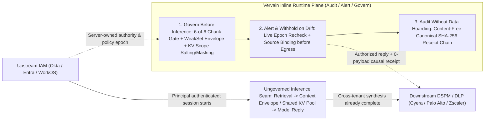

# Vervain: The Runtime Governance Layer After IAM

**Executive Enterprise Brief | Architecture, Runtime Primitives, Deployment Wedge, and Explicit Claim Boundaries**

> [!IMPORTANT]
> **Build Evidence Posture (Pre-`GPU GO`):**
> - **Hosted Frontier Plane (`Google Gemini` via `@google/genai`):** Active in this repository across `2 of 2` declared application boundaries (`retrieval_to_gemini_context_envelope` and `gemini_response_to_browser_release`), excluding provider-internal KV caches/weights and direct unmediated API calls.
> - **Self-Hosted Open-Weight GPU Plane (`vLLM` / `H200`):** `0 of 1` live H200 GPU runs are recorded in this build prior to `GPU GO` (`NO GPU RUN RECORDED`).
> - **Scoped Attention & Open-Weight KV Lab:** `Reference scoped-attention proof. Not integrated with Gemini internals or a production vLLM attention backend. No latency or isolation claim.`

---

## 1. Core Thesis: Why Inference Itself Is Ungoverned Today

Enterprise security stacks bracket AI applications at the outer edges while leaving the inference runtime itself unmediated:

1. **Identity Ends at Session Authentication (`IAM`):** Enterprise identity providers (`Okta`, `Microsoft Entra`, `WorkOS`) establish *who* a human user, service account, or workload principal is when a request begins. Once authentication succeeds, IAM steps out of the execution path. It has zero visibility into which database rows, vector-store chunks, or session summaries an application retriever assembles into an outbound model prompt, and zero ability to halt an in-flight generation when a policy epoch rotates milliseconds later.
2. **DLP and DSPM Act Only After Egress (`Post-Facto`):** Data security posture management and network egress tools (`Cyera`, `Palo Alto Networks`, `Zscaler`) catalog static repositories at rest or scan completions *after* the model has already processed cross-tenant context. Once Tenant B's confidential record enters Tenant A's prompt envelope or shared KV cache, attention weights blend both tenants' representations during token synthesis; system-prompt instructions and regex egress filters arrive after cross-tenant mixing has already occurred.
3. **The Open-Weight and Neocloud Shift Widens the Memory Gap:** Roughly `1 of 3` enterprise inference tokens (`~33%` across surveyed hybrid and self-hosted enterprise AI workloads, excluding consumer chat traffic) now execute on open-weight serving engines (`vLLM`, `SGLang`, `Ollama`, `NVIDIA Dynamo`) and multi-tenant neocloud GPU pools without pre-inference context admission or KV-memory governance. Across those runtimes, tenant separation fails at two distinct layers:
   - **Hosted Frontier APIs (`Google Gemini`):** A single omitted tenant predicate in retrieval (`cross_tenant_filter_omission`) places foreign records directly into the outbound provider context envelope.
   - **Open-Weight & Disaggregated GPU Pools (`vLLM`, `SGLang`, `Ollama`, `NVIDIA Dynamo`):** Shared automatic prefix caches hash token sequences without tenant/epoch salting (`prefix_cache_hash_collision`), physical paged-KV block allocators recycle freed block IDs across requests with stale generation counters (`stale_allocation_generation`), and buggy block tables expose foreign physical KV slots before attention softmax (`contaminated_block_table`).

### The Two-Sentence Strategic Anchor

- **Platform Thesis:** Your identity system can tell you an agent was permitted to read a customer record when a session started; Vervain shows what context entered inference afterward, withholds cross-scope inputs before model attention, and records what policy revocation actually reached.
- **Commercial Door:** During enterprise security reviews, buyers ask AI vendors one blocking question: *"Can you demonstrate today, at the request level, that one customer's data has never entered another customer's model context?"* Vervain answers that question in a 1-week cross-tenant contamination assessment using payload-free receipts, then enforces the boundary inline.

---

## 2. Three Runtime Primitives (`Audit · Alert · Govern`)

Vervain enforces deterministic TypeScript and systems code at the context, memory, and release boundaries; the LLM is never consulted as a permission oracle.

### 2.1 Primitive 1 of 3: Govern Before Inference

- **Server-Owned Authority Binding (`src/server/session.ts`, `src/shared/contracts.ts`):** Tenant identity, principal, policy ID, policy epoch, and 32-bit `uint32` request scope tag (`0x00a1de07` for `Tenant Alder`, `0x00beac11` for `Tenant Beacon`) derive solely from HMAC-SHA256 server sessions. Across `100%` of `/api/*` endpoints (`10 of 10` routes: `5 of 5` `POST` mutation routes and `5 of 5` `GET` inspection routes, excluding host OS root access), `detectClientAuthorityOverride` rejects `25 of 25` normalized client authority, scope, session, and model override keys with HTTP `400` (`authority_override_rejected`).
- **Deterministic 6-Step Pre-Inference Chunk Admission (`src/server/admission.ts`):** Before any hosted provider SDK call, `evaluateContextAdmission` checks `100%` of candidate retrieved chunks in strict `6 of 6` sequence (excluding upstream mislabeling at original data ingest):
  1. Schema completeness, identifier regex conformance, and null-byte absence (`malformed_chunk`, `schema_incomplete`, `missing_provenance`).
  2. Authoritative frozen record lookup plus recomputed SHA-256 content and version digest equality (`unrecognized_source`, `digest_mismatch`).
  3. Server-owned `tenantId` equality (`tenant_mismatch`).
  4. Active `policyEpoch` equality (`stale_policy_epoch`).
  5. Declared destination (`gemini.context`) classification allowlist (`disallowed_classification`; `1 of 2` fixture classifications allowed).
  6. Per-chunk size (`<= 4096` UTF-8 bytes) and per-envelope count (`<= 4` admitted chunks) caps (`chunk_size_exceeded`, `chunk_count_exceeded`).
- **`WeakSet`-Branded Outbound Envelopes for `Google Gemini` (`src/server/envelope.ts`):** Only records passing all `6 of 6` checks are minted as frozen `AdmittedChunk` instances carrying both a compile-time `unique symbol` brand and registration in module-private `VERIFIED_ADMITTED_CHUNKS` (`WeakSet`). `buildVervainGeminiEnvelope` verifies `isVerifiedAdmittedChunk` on `100%` of included chunks before invoking the official server-side `@google/genai` SDK (`gemini-2.5-flash`). On `paired_defect` (`fixture.northstar-renewal.v1`), `1 of 2` retrieved chunks (`alder/renewal-playbook-v3`) enters the governed envelope while `1 of 2` foreign chunks (`beacon/strategy-note-v2`) is withheld (`0` foreign bytes transmitted to Google Gemini).
- **Scope-Salted Prefix Caching (`cache_salt`) and Block-Header Masking for Open-Weight Engines (`src/server/scoped-attention.ts`):** For self-hosted open-weight engines (`4 of 4` lifecycle modes modeled in TypeScript reference code; `0 of 1` GPU kernel runs recorded in this repo prior to `GPU GO`), Vervain binds the server-owned `uint32` scope tag and policy epoch into two mechanisms:
  1. **HMAC Prefix-Cache Key Salting (`cache_salt`):** Incorporates tenant authority and `policyEpoch` into content-addressed prefix hashes (`vLLM` `--prefix-caching-hash-algo sha256_cbor`, `SGLang` RadixAttention) so identical multi-tenant system prompts map to distinct physical KV blocks.
  2. **Block-Header `(scope_tag, alloc_generation)` Masking:** Evaluates physical block side-array metadata prior to loading `K`/`V` tiles or computing max-shifted softmax. In the `4`-block paged-KV reference pool (`blockSize = 2`, `headDim = 4`), `1 of 4` foreign-scope blocks is masked to `0.000000` of `1.000000` post-softmax attention mass while `3 of 4` authorized blocks match the clean `[0, 2, 3]` twin with `0` max absolute delta across `4 of 4` output dimensions.

### 2.2 Primitive 2 of 3: Alert & Withhold on Authority Drift

- **Nonstreaming Pre-Release Authority Gate (`src/server/release.ts`):** Rather than streaming unverified tokens to the browser and attempting post-hoc retraction, `ResponseReleaseGate.evaluateRelease` buffers the structured candidate JSON reply (`<= 8192` UTF-8 bytes, `maxOutputTokens = 256`; trading higher time-to-first-token for pre-release gate completeness, with token streaming explicitly excluded) and executes `4 of 4` checks before `1` byte leaves the server:
  1. **Single-Release Idempotency:** Permits at most `1 of 1` release evaluation per `requestId` (`duplicate_release_blocked` on replay).
  2. **Live Authority & Policy-Epoch Continuity:** Reloads `SessionStore` and verifies `5 of 5` live session bindings (`sessionId`, `tenantId`, `principalId`, `stateGeneration`, and `policyEpoch`) plus non-expiration. If an administrator revokes access mid-generation (`epoch 7 -> 8`), the reply is withheld with `policy_epoch_changed` (`releasedAnswer = null`, `permittedTaskCompleted = false`).
  3. **Admitted-Source Citation Binding:** Enforces `parseStrictJson` on model JSON output and verifies `100%` of `parsedSourcesUsed` (`<= 8` deduplicated IDs) are members of `envelope.includedSourceIds`, withholding hallucinated or unauthorized source references with `unbound_source_citation`.
  4. **Bounded Planted-Value Tripwire:** Scans candidate output against `1 of 1` synthetic marker (`BEACON_PROJECT_EMBER_742`, withholding on exact match with `planted_value_detected`, while explicitly excluding arbitrary semantic paraphrase).

### 2.3 Primitive 3 of 3: Audit Without Data Hoarding

- **Content-Free Canonical JSON SHA-256 Chain (`src/server/ledger.ts`, `src/server/receipts.ts`, `src/server/redaction.ts`):** Every workflow arm appends `6 of 6` deterministic stage events (`retrieval`, `admission`, `provider_dispatch`, `provider_completion`, `release_decision`, `observed_outcome`) serialized via lexicographically sorted canonical JSON (RFC 8785 key-sorted canonical JSON structure) and chained from `GENESIS_CHAIN_SHA256` into `vervain.context-firewall.receipt.v1`.
- **Zero Raw Text or Secret Retention:** Before ledger persistence, `findProhibitedContentInObject` recursively scans `100%` of receipt keys and string values to enforce `0` raw prompt bytes, `0` document chunk bytes, `0` model answer bytes, `0` planted tokens, and `0` session cookies or API keys in logs and exported receipts (in-memory instance chain detects single-byte tampering or event swaps via `GET /api/ledger/verify`, excluding container restart or full-store rollback without an external checkpoint).
- **Answering the `5 of 5` CISO Governance Questions:**

| Governance Question (1-5 of 5) | Deterministic Receipt & Ledger Fields (`vervain.context-firewall.receipt.v1`) | Data-Minimization Guarantee & Scope Exclusion |
| :--- | :--- | :--- |
| **1. Who** initiated and owned the inference authority? | `tenant_digest_sha256`, `principal_digest_sha256`, `session_digest_sha256`, `policy_id` | Domain-separated SHA-256 digests (`0` raw session cookies or bearer tokens stored; synthetic persona fixture in demo). |
| **2. What** candidate records were retrieved, admitted, or withheld? | `counts` (`admitted` / `withheld` / `unknown` over `denominator_total_retrieved`), `sources[].source_version_sha256`, `content_sha256`, `outbound_envelope.envelope_sha256` | Exact structural denominators and cryptographic digests (`0` raw document or prompt bytes retained). |
| **3. When** did authority bind relative to policy rotation? | `timestamps.started_at_iso`, `completed_at_iso`, `duration_ms`, `policy_epoch_at_admission` -> `policy_epoch_at_release` | Captures TOCTOU drift across admission and release (`epoch 7 -> 7` vs `epoch 7 -> 8` mid-flight revocation). |
| **4. How** was the boundary enforced and verified? | `mediated_boundaries` (`2 of 2` in this app), `provider` (`google-gemini`, `model_id`, `transport_mode`, `latency_ms`, `retry_count`), `chain.current_receipt_chain_sha256` | Distinguishes `live` `@google/genai` transport from `mock` offline mode; never substitutes fake replies on `provider_unavailable`. |
| **5. Why** was a chunk or reply released or withheld, and what remained out of scope? | `sources[].reason_code`, `release.reason_code`, `permitted_task.basis`, `exclusions` (`7 of 7` named exclusions) | Pairs every disposition with a fixed machine-readable reason code and explicit non-mediated exclusions. |

---

## 3. High-Stakes Deployment Wedge

### 3.1 Entry Motion: 1-Week Cross-Tenant Contamination Assessment

Observe-only governance dashboards stall in procurement; concrete cross-tenant defects force immediate engineering action. Vervain enters multi-tenant AI teams through a **1-week cross-tenant contamination assessment** triggered when (1) an enterprise customer security review blocks a commercial deal, or (2) platform engineers suspect cross-tenant bleed across shared vector indices, memory tables, or self-hosted prefix caches.

1. **Days 1-2 (Zero-Payload Instrumentation):** Deploy Vervain's gateway and retrieval/cache taps across hosted API envelopes (`Google Gemini`) and open-weight serving endpoints (`vLLM`, `SGLang`, `Ollama`, `NVIDIA Dynamo`) in observe-first receipt mode (`0` raw customer text exported).
2. **Days 3-5 (Defect Attribution):** Measure retrieval-to-envelope tenant mismatches, stale-epoch admissions, and (for self-hosted tiers) cross-salt KV block reuse, producing request-scoped `vervain.context-firewall.receipt.v1` bug tickets with exact denominators and exclusions.
3. **Conversion to Inline Enforcement:** Flip mediated paths into inline pre-inference context admission, `cache_salt` enforcement, and pre-release epoch gating without rewriting upstream IAM or downstream application retrievers.

### 3.2 Four Modeled High-Stakes Deployment Sectors (`4 of 4` Enterprise Presets)

The prototype models `4 of 4` enterprise architecture presets (`EnterprisePresetId` across `5 of 5` runtime profiles, where `1 of 5` - `Google Gemini` - executes live outbound SDK mediation in this service and `4 of 5` open-weight engines execute deterministic TypeScript KV/Scoped Attention simulations):

| Sector Preset (`1-4 of 4`) | Upstream IAM | Inference Runtime Target | Why IAM + Egress DLP Miss the Defect | Vervain Inline Intervention & Explicit Denominator |
| :--- | :--- | :--- | :--- | :--- |
| **1. Multi-Tenant SaaS RAG (`northstar_commercial`)** | `Okta` / `WorkOS` OIDC | Hosted `Google Gemini` (`gemini-2.5-flash` via `@google/genai`) | Valid `Tenant Alder` session hits `cross_tenant_filter_omission`; DLP cannot un-mix `Tenant Beacon` pricing strategy once synthesized. | Pre-inference gate admits `1 of 2` retrieved chunks (`alder/renewal-playbook-v3`), withholds `1 of 2` (`tenant_mismatch`), and releases Alder's renewal summary (`epoch 7 -> 7`). |
| **2. Shared-GPU Neocloud Pools (`neocloud_shared_gpu`)** | Workload OIDC / mTLS | `vLLM`, `SGLang`, `NVIDIA Dynamo` disaggregated KV pools | Shared system prompts collide onto un-salted prefix-cache hashes; recycled paged-KV blocks retain stale generation tags across co-scheduled tenants. | `cache_salt` HMAC prefix isolation + side-array `(scope_tag, alloc_generation)` block gating (`1 of 4` foreign KV blocks masked to `0.000000` mass in TypeScript reference proof; `0 of 1` GPU runs recorded pre-`GPU GO`). |
| **3. Institutional MNPI Deal Walls (`institutional_mnpi_wall`)** | `Microsoft Entra` deal-wall groups | Hosted `Google Gemini` + self-hosted `vLLM` | Analyst loses wall clearance while long-context synthesis is already running; egress keyword regex misses paraphrased deal posture. | Destination classification gate (`gemini.context`) pre-inference + `ResponseReleaseGate` withholding buffered reply (`0` bytes released) on mid-flight `policy_epoch_changed` (`epoch 7 -> 8`). |
| **4. Clinical Care Triage (`clinical_care_triage`)** | Hospital EHR SMART-on-FHIR session | On-prem `Ollama` / `vLLM` open-weight clinical models | Cross-encounter chart retrieval mixes prior patient notes into local runner context; audit logs cannot retain raw PHI payloads. | Encounter-scoped chunk admission + `unbound_source_citation` release check + content-free SHA-256 receipts (`0` PHI text bytes written to `AuditLedger`). |

---

## 4. Explicit Boundaries & Non-Claims

Every technical claim in this repository is partitioned strictly between what executes live in this Node.js service today, what runs as deterministic TypeScript reference math, what awaits post-`GPU GO` independent verification, and what remains explicitly unmediated:

| Architectural Surface | Status in This Build (`vervain-cf-0.1.0-carbon`) | Verification Artifact & Denominator | Explicit Scope Exclusions & Non-Claims |
| :--- | :--- | :--- | :--- |
| **Hosted `Google Gemini` Context & Reply Mediation** | **Active (`2 of 2` app boundaries mediated)** | `evaluateContextAdmission` (`6 of 6` checks), `WeakSet`-sealed `AdmittedChunk[]`, `OfficialGoogleGenAITransport` (`@google/genai`), `ResponseReleaseGate` (`4 of 4` checks), covered by `npm test` + Playwright E2E. | Mediates only requests traversing `src/server/workflows.ts` (`retrieval_to_gemini_context_envelope` and `gemini_response_to_browser_release`). Excludes Gemini internal KV cache/weights, direct unmediated SDK calls, streaming TTFT, and semantic paraphrase beyond exact `BEACON_PROJECT_EMBER_742` scan. |
| **Content-Free Causal Receipts & Hash Chain** | **Active (In-Instance RAM Ledger)** | `6 of 6` chained stage events per workflow arm (`vervain.context-firewall.event.v1`), `vervain.context-firewall.receipt.v1`, recursive `findProhibitedContentInObject` check (`0` raw text/secret bytes). | Tamper-evident within the live server process (`GET /api/ledger/verify`). Excludes persistence across container restarts and full-store rollback resistance without an external checkpoint. |
| **Open-Weight 4-Mode KV Lifecycle & Scoped Attention Workbench** | **Reference Simulation Only (CPU TypeScript)** | `src/server/scoped-attention.ts` (`4 of 4` KV modes, `4` physical blocks, `80 of 80` seeded FlashAttention-2 `(m_i, l_i, O_i)` trials within `<= 1e-12`, ES `Proxy` `0`-read foreign/stale block skip). | `Reference scoped-attention proof. Not integrated with Gemini internals or a production vLLM attention backend. No latency or isolation claim.` Excludes CUDA/Triton/FlashInfer kernels, GPU HBM tensor zeroization, and hardware timing side channels. |
| **Self-Hosted H200 `vLLM` Depth Adapter (`Carbon 2` + `Carbon 3`)** | **`NO GPU RUN RECORDED` (`0 of 1` live GPU runs pre-`GPU GO`)** | Independent Carbon 3 verifier (`inference-proof.v1` -> `verifier-result.v1`, `73 of 73` reason codes, `31 of 31` adversarial mutation campaigns, Ed25519 `trust-root.v1`). | UI badge defaults strictly to `NO GPU RUN RECORDED` (`NOT_CONFIGURED`) until an owner-authorized post-`GPU GO` H200 `RUN_DIR` bundle passes `verify_h200_run.sh` with verified signature, SHA-256 digest match, `0` sanitizer findings, and multi-rank agreement. |
| **Enterprise Identity, External Tools & Third-Party Attestations** | **Explicitly Out of Scope** | `7 of 7` `RECEIPT_EXCLUSIONS` embedded inside every UI receipt drawer and exported JSON file. | Persona switcher (`alder` / `beacon`) is a labeled synthetic demo fixture (`synthetic_fixture_not_authentication`), not enterprise OIDC/SAML/mTLS login. Excludes MCP/tool execution, external vector DBs, host root admins, and regulatory attestations. |
